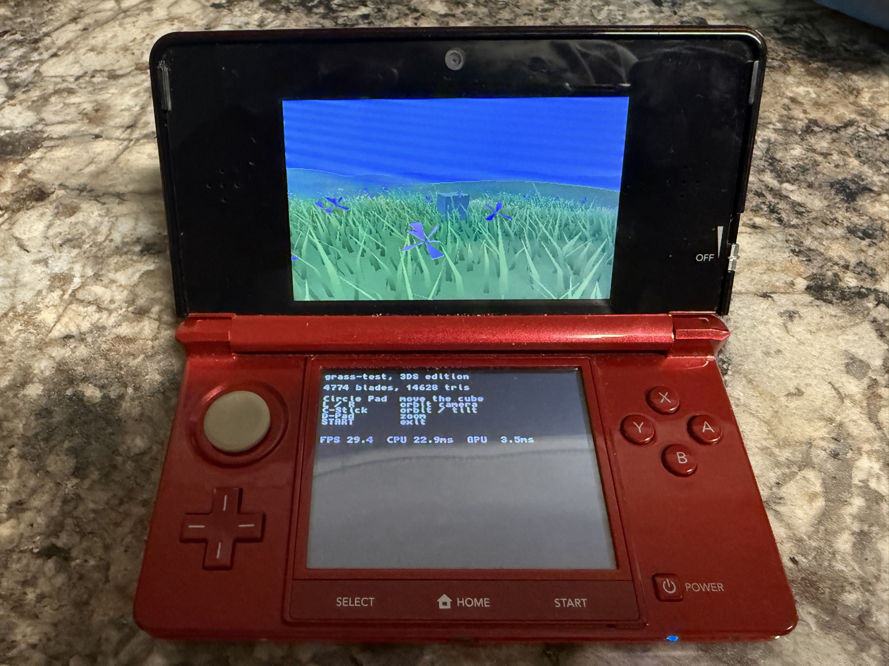
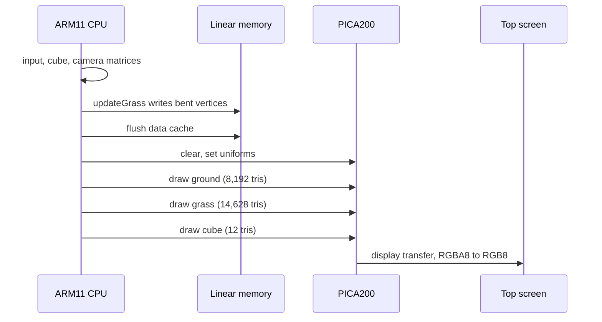

# grass-test, 3DS edition

A procedural grass meadow running on real Nintendo 3DS hardware, written in C with [libctru](https://github.com/devkitPro/libctru) and [citro3d](https://github.com/devkitPro/citro3d). It is a port of [grass-test](https://github.com/jesusthecreator017/grass-test), a Rust and wgpu renderer that builds every grass blade on the GPU with a compute shader. The 3DS GPU has no compute shaders, so this version moves that work to startup and to the CPU, and keeps the look: hashed blades, clumps, dry patches, iris flowers, wind gusts and a cube that pushes grass aside.



*On an original 3DS: 4,774 blades, 14,628 grass triangles, 29.4 FPS, 22.9 ms CPU and 3.5 ms GPU per frame.*

## Running

You need [devkitPro](https://devkitpro.org/wiki/Getting_Started) with the 3DS packages (devkitARM, libctru, citro3d, picasso, 3dsxtool, bin2s):

```sh
sudo dkp-pacman -S 3ds-dev
make            # builds grass.3dsx (and hello.3dsx)
```

The Makefile assumes devkitPro lives in `/opt/devkitpro`. Override it with `make DEVKITPRO=/path/to/devkitpro`.

Copy `grass.3dsx` to `/3ds/` on the SD card and start it from the Homebrew Launcher, or send it over Wi-Fi with `3dslink grass.3dsx`.

| Input | Action |
|---|---|
| Circle Pad | Move the cube (relative to the camera) |
| L / R | Orbit the camera |
| C-Stick | Orbit and tilt (New 3DS only) |
| D-Pad up / down | Zoom |
| START | Exit |

The top screen shows the meadow. The bottom screen shows the blade and triangle counts and, every 30 frames, the FPS plus citro3d's CPU and GPU time for the frame.

## From compute shaders to a 2011 handheld

The PC version and this one share the same idea: **a blade is a pure function of its grid cell.** Hash the integer cell coordinates and you get the same random numbers every time, so a blade never needs to be stored or authored. What changes is where and when that function runs.

| | grass-test (PC) | 3DS edition |
|---|---|---|
| GPU | Any wgpu backend (Vulkan, Metal, DX12) | PICA200, fixed-function fragment stage |
| Blade generation | Compute shader, every frame | CPU, once at startup |
| Blade count | ~50,000 on screen, from far larger candidate grids | 4,774, from 6,724 candidate cells |
| Field | 200 m, two LODs, culled every frame | 14 m × 14 m, no culling |
| Blade geometry | Bézier strip, 15 or 7 vertices, built in the vertex shader | 5-vertex strip, built on the CPU |
| Wind and pushers | Compute and vertex shader | CPU loop over every vertex, every frame |
| Shading | Lighting, translucency, specular, PCF shadows | Baked vertex colours and distance fog |
| Draw | `draw_indirect`, count never reaches the CPU | `C3D_DrawElements` with 16-bit indices |
| Shaders | WGSL | PICA200 assembly (`shader.v.pica`) |

```mermaid
flowchart LR
    subgraph START["Startup, once"]
        direction TB
        G1["Hash each 17 cm cell"] --> G2["Thin near edge and path,<br/>pick height, colour, flower"]
        G2 --> G3["Write blade offsets<br/>to base[] in main RAM"]
        G3 --> G4["Build ground grid and cube"]
    end

    subgraph FRAME["Every frame, CPU"]
        direction TB
        F1["Read input, move cube,<br/>place camera"] --> F2["updateGrass:<br/>wind + pusher bend<br/>every vertex"]
        F2 --> F3["Flush data cache"]
    end

    subgraph GPU["Every frame, PICA200"]
        direction TB
        V["Vertex shader:<br/>transform + fog"] --> P["Fixed-function:<br/>vertex colour only"]
    end

    G4 --> F1
    F3 -- "linear memory VBO" --> V
```



## Startup: building the meadow

All of this is in `buildGrass()` in [`grass.c`](grass.c).

### Candidate grid

The field covers 14 m × 14 m (`FIELD = 7`, from −7 to 7 on X and Z) with one candidate cell every 17 cm (`SPACING`), an 82 × 82 grid of 6,724 cells. Each cell's blade is jittered inside its cell with `rnd(ix, iz, salt)`, a 32-bit integer hash of the cell coordinates. Different salts decorrelate the uses: jitter on X, jitter on Z, keep roll, height, facing, width, lean, flower roll and so on.

### Thinning

A blade is dropped, or shortened, near two features:

- **Field edge:** a smoothstep over the outer 1.5 m, so the meadow ends in a soft fringe instead of a square.
- **Dirt path:** a sine-shaped path crosses the field (`pathDist`). Grass fades out within about 1.3 m of its centre line.

The product of the two is a `keep` value. A per-cell roll against it discards blades, and survivors near the boundary are shorter. About 70% of the cells survive, which gives the 4,774 blades.

### Variation

Each blade layers several noise sources, the same recipe as the PC version at a smaller scale:

- **Tall patches:** value noise at about 3 m scale raises or lowers height.
- **Clumps:** one hash per 70 cm cell gives a shared height and colour shift to nearby blades.
- **Dry patches:** a second value noise blends root and tip colours towards straw.
- **Stragglers:** 4% of blades are 1.6× taller.
- **Colour:** a dark root and a lighter tip, interpolated up the blade, tinted by clump and dryness.

### Blade geometry

A blade is a tapered, bowed strip of **3 triangles and 5 vertices**: two pairs at 0% and 55% of the height, then a single tip vertex. Widths shrink from 50% to 32% to 0 of the blade width. The blade leans along its facing direction by `lean × t² × height`, which bows it into a curve rather than a straight stick.

The vertices are stored in `base[]` as offsets from the blade's root, so the per-frame bend only has to work in the blade's local space.

### Iris flowers

In green areas, 1.2% of blades become irises: a thin, nearly straight stem with a head of six triangles around its tip, three drooping petals and three upright ones, in blue or pale lavender. On the run in the photo, 51 blades are flowers.

### Ground

The ground is a 64 × 64 grid of quads (8,192 triangles) covering 180 m × 180 m. Its vertex spacing is quadratic (`x = u·|u|·90`), so the grid is dense under the grass and coarse at the horizon, using one fixed vertex budget. Vertex colours blend grass green to path brown by the same `pathDist` function the blades use, so turf and dirt line up with where grass grows.

Terrain height is the same sum of sines as `terrain::height` in grass-test, so the hills have the same shape on both platforms.

## Every frame: bending on the CPU

`updateGrass()` runs over every blade and every vertex once per frame.

**Wind.** Each blade gets a bend vector along a fixed wind direction (0.8, 0.6):

```c
float w = (0.22f + 0.16f * sinf(t * 1.3f - b->rx * 0.45f - b->rz * 0.3f)
           + 0.05f * sinf(t * 3.1f + b->phase)) * b->stiff;
```

The first sine includes the blade's position, so gusts roll across the field as visible waves. The second uses a per-blade phase for flutter. Flowers have half the stiffness factor, so they sway less.

**Pusher.** Blades within 60 cm of the cube are pushed directly away from it, with a strength that rises towards the cube's centre.

**Length-preserving bend.** A plain shear would stretch bent blades. For each vertex at height fraction `f = y / h`:

```c
float sc = 1.0f / sqrtf(1 + b2 * f * f);   // b2 = |bend|²
float l  = s[j].y * f * sc;
o[j].x = b->rx + s[j].x + bx * l;
o[j].y = b->ry + s[j].y * sc;
o[j].z = b->rz + s[j].z + bz * l;
```

The vertex moves sideways by the bend, scaled by `f²`, and its height drops by the same factor `sc`. The blade bows over instead of growing taller as it leans.

**Uploading.** The bent vertices are written straight into `grassVbo`, which is allocated with `linearAlloc` so the GPU can read it. The CPU's data cache is then flushed (`GSPGPU_FlushDataCache`) so the GPU sees this frame's vertices, not stale ones.

Colours are copied into `grassVbo` once at startup and never touched again. Only positions change per frame.

## The vertex shader

The PICA200 vertex shader is in [`shader.v.pica`](shader.v.pica), written in its assembly language and assembled by `picasso`. It does two things:

1. **Transform:** four `dp4` instructions apply the model-view matrix, four more apply the projection.
2. **Distance fog:** the fog factor is view-space depth times `fog.x` (1/110 per metre), clamped to 1. The output colour is `mad(sky − colour, factor, colour)`, a linear blend towards the sky colour.

Fog does the job that the far LOD does on PC. It hides where the ground grid gets coarse and gives the hills depth without any lighting.

The fragment stage is the PICA200's fixed-function texture combiner, set to output the interpolated vertex colour (`GPU_PRIMARY_COLOR`, `GPU_REPLACE`). Face culling is off, since blades are single strips seen from both sides.

## Frame order



## Performance

Measured on an original 3DS (268 MHz ARM11, `osSetSpeedupEnable` has no effect on this model):

| Metric | Value |
|---|---|
| Blades | 4,774 |
| Grass triangles | 14,628 |
| Frame rate | 29.4 FPS |
| CPU time per frame | 22.9 ms |
| GPU time per frame | 3.5 ms |

The scene is **CPU-bound**. The GPU finishes in 3.5 ms, but the CPU spends most of the frame in `updateGrass`, which runs a square root and several multiplies for each of the roughly 25,000 grass vertices. That misses the 16.7 ms budget for 60 FPS, so the frame lands on 30.

The next step is to move the bend into the vertex shader. The PICA200 has `rsq`, `mad` and `mul`, which is everything the bend formula needs, and the blade root, phase and stiffness could travel as extra vertex attributes. The CPU would then only update a time uniform and the cube position, and the GPU, which has plenty of headroom, would do the per-vertex work.

## Known limits

- **CPU-bound** at 30 FPS on an original 3DS, as above.
- **16-bit indices:** the grass buffer is capped at 60,000 vertices (`MAX_VERTS`) so every index fits in a `u16`. A bigger field needs several draw calls.
- **No culling or LOD:** every blade is bent and drawn every frame, on screen or not.
- **No lighting or shadows:** colour is baked per vertex and only fog varies with the view.
- **No stereoscopic 3D:** only the left eye of the top screen is rendered.
- **Fixed field:** the meadow is regenerated identically on every launch, with no editor or density map.

## Project layout

```
grass.c          the meadow: generation, per-frame bending, drawing, input
shader.v.pica    PICA200 vertex shader: transform and distance fog
main.c           hello-world, the first test that the toolchain works
Makefile         builds grass.3dsx and hello.3dsx with devkitARM
docs/            hardware photo
```

## Credits

- Technique: Sucker Punch Productions, *Procedural Grass in Ghost of Tsushima* (GDC 2021), by way of grass-test.
- Toolchain and libraries: [devkitPro](https://devkitpro.org) (devkitARM, libctru, citro3d, picasso).
